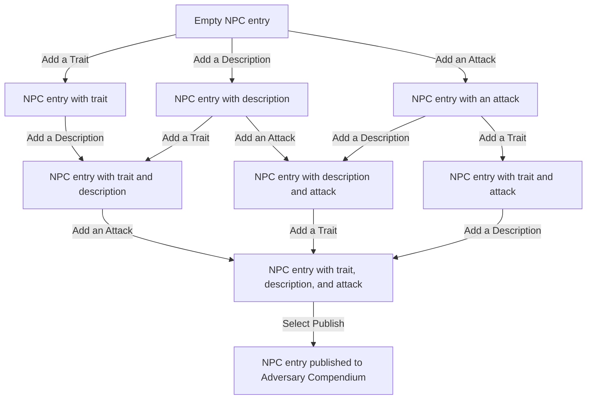

Fultimator

This application is a tool used by Game Masters to create content for the tabletop RPG Fabula Ultima.

- **URL:** [Fultimator: NPC Gallery](https://fultimator.com/npc-gallery)
- **Feature To Test:** Creating an NPC using the NPC Gallery tool.

Equivalence Partitioning

This equivalence partitioning table tests the possible values for the Level field in the NPC statblock editor.

| Classification    | Partition             | Range or Condition    | Expected Result                       |
| ----------------- | --------------------- | -------------------   | -----------------------------------   |
| NPC Level         | Invalid low           | Less than 0           | `ValueError`                          |
| NPC Level         | Invalid high          | More than 60          | `ValueError`                          |
| NPC Level         | Valid                 | Multiple of 5         | Accepted by Level field               |
| NPC Level         | Invalid               | Not a multiple of 5   | `ValueError`                          |

Decision Table Testing

This decision table tests the conditions for when an NPC statblock may be published to the public NPC database called the Adversary Compendium.

| Conditions                        | 1     | 2     | 3     | 4     | 5     | 6     | 7     | 8     |
| ---                               | ---   | ---   | ---   | ---   | ---   | ---   | ---   | ---   |
| Traits added to NPC entry         | T     | T     | T     | T     | F     | F     | F     | F     |
| Description added to NPC entry    | T     | F     | T     | F     | T     | F     | T     | F     |
| Attacks added to NPC entry        | T     | F     | F     | T     | F     | T     | T     | F     |

| Actions                           | 1     | 2     | 3     | 4     | 5     | 6     | 7     | 8     |
| ---                               | ---   | ---   | ---   | ---   | ---   | ---   | ---   | ---   |
| Publish to Adversary Compendium   | T     | F     | F     | F     | F     | F     | F     | F     |

### Test Cases

Each test case is based on one column of the decision table.

| Test ID | Trait Added | Description Added | Attack Added | Expected Result                                    |
| ------- | ----------- | ----------------- | ------------ | -------------------------------------------------  |
| DT01    | Yes         | Yes               | Yes          | Valid |
| DT02    | Yes         | No                | No           | `Value Error` thrown                               |
| DT03    | Yes         | Yes               | No           | `Value Error` thrown                               |
| DT04    | Yes         | No                | Yes          | `Value Error` thrown                               |
| DT05    | No          | Yes               | No           | `Value Error` thrown                               |
| DT06    | No          | No                | Yes          | `Value Error` thrown                               |
| DT07    | No          | Yes               | Yes          | `Value Error` thrown                               |
| DT08    | No          | No                | No           | `Value Error` thrown                               |

State Transition Testing

### Test Cases

Each valid test case covers one transition from the state diagram, followed by invalid transitions and one complete creation sequence.

| Test ID | Init State              | Event         | Expected                                 |  Result                   |
| ------- | ----------------        | ------        | ---------                                | ------------              |
| ST01    | Empty NPC entry         | Add a Trait   | NPC entry with trait                     | The trait is added.       |
| ST02    | NPC entry with trait    | Add a Description   | NPC entry with trait and description     | The description is added. |
| ST03    | NPC entry with trait and description    | Add an Attack                             | NPC entry with trait, description, and attack | The attack is added.                      |
| ST04    | NPC entry with trait, description, and attack | Select Publish       | NPC entry published to Adversary Compendium | The entry is published.                    |
| ST05    | Empty NPC entry                         | Add a Description         | NPC entry with description            | The description is added.                        |
| ST06    | NPC entry with description              | Add a Trait               | NPC entry with trait and description  | The trait is added.                              |
| ST07    | NPC entry with description              | Add an Attack             | NPC entry with description and attack | The attack is added.                             |
| ST08    | NPC entry with description and attack   | Add a Trait               | NPC entry with trait, description, and attack | The trait is added.                       |
| ST09    | Empty NPC entry                         | Add an Attack             | NPC entry with an attack              | The attack is added.                             |
| ST10    | NPC entry with an attack                | Add a Trait               | NPC entry with trait and attack       | The trait is added.                              |
| ST11    | NPC entry with an attack                | Add a Description         | NPC entry with description and attack | The description is added.                       |
| ST12    | NPC entry with trait and attack         | Add a Description         | NPC entry with trait, description, and attack | The description is added.                 |
| ST13    | Empty NPC entry                         | Select Publish            | Empty NPC entry                       | The entry is not published; publishing requires a trait, a description, and an attack. |
| ST14    | NPC entry with trait                    | Select Publish            | NPC entry with trait                  | The entry is not published; a description and an attack are missing. |
| ST15    | NPC entry published to Adversary Compendium | Add a Trait           | NPC entry published to Adversary Compendium | Published entries cannot be modified.      |
| ST16    | Empty NPC entry                         | Add a Trait, add a Description, add an Attack, select Publish | NPC entry published to Adversary Compendium | The entry is published after the complete creation sequence. |

