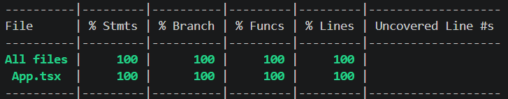

# Lab: Exploratory and White Box Testing

## Topics

- Exploratory testing
- White box testing
- Statement coverage
- Code coverage
- React component testing

## Learning Objectives

- Perform a focused exploratory testing session.
- Examine source code to identify statements, branches, and loops.
- Design white box tests based on the internal structure of an application.
- Test React state changes and user interactions.
- Use a coverage report to evaluate test coverage.
- Compare tests created before and after viewing the source code.

# Deliverables

## Step 1: Exploratory Testing

Run the counter application without looking at the source code.

Write a short testing charter that describes what you plan to investigate.

Record at least **five actions or combinations of actions** you tried. For each one, include:

- What you did
- What you expected
- What happened
- Whether the test passed or failed

<details>
<summary>Exploratory testing table</summary>

| Action                | Expected Result            | Actual Result | Pass or Fail |
| --------------------- | -------------------------- | ------------- | ------------ |
| Select Increment once | The count increases by one | The count increases by one | Pass |
| Select Decrement once | The count decreases by one | The count decreases by one | Pass |
| Select Decrement until count is below 0 | The count decreases below 0 | The count decreases below 0 | Pass |
| Select Reset to set count to 0 | The count resets to 0 | The count resets to 0 | Pass |
| Select Increment ten times, then select Decrement ten times | The count equals 0 | The count equals 0 | Pass |

</details>

## Step 2: Examine the Source Code

After completing your exploratory testing, examine the source code in `App.tsx`.

Identify:

- The starting value of `count`
- The statements that change `count`
- The user action that causes each statement to execute
- Any branches or loops in the code

Explain whether branch coverage and loop coverage apply to this component.

<details>
<summary>Source Code Examination</summary>
The starting value of `count` is 0. The statements that change count are lines 9-11 in the onClick events for each button. There is no loop in the code, so loop coverage would not apply to this component. Branch coverage would apply to this code because there are multiple variations of actions that can be taken with the code.
</details>

## Step 3: Create the Test File

Create the following test file:

```text
src/App.test.tsx
```

Use React Testing Library to render the component and interact with its buttons.

Your tests should use:

- `render` to render the component
- `screen` to find elements
- `fireEvent` or `userEvent` to select buttons
- Jest assertions to verify the displayed count

Organize your tests inside a `describe` block.

## Step 4: Test the Starting State

Write a test that verifies the component's initial state.

Confirm that:

- The component displays `Count: 0`
- The Increment button appears
- The Decrement button appears
- The Reset button appears

## Step 5: Test Statement Coverage

Write tests that execute each statement that changes the count.

Include tests that verify:

- Increment changes the count from `0` to `1`
- Decrement changes the count from `0` to `-1`
- Reset changes the count back to `0`

The Reset test must first change the count to a value other than `0`.

## Step 6: Test a Sequence of Actions

Write at least **one additional test** that performs multiple actions in sequence.

For example, you could:

- Increment several times
- Decrement after incrementing
- Reset after several changes
- Continue using the buttons after resetting

Check the displayed count after each important action.

## Step 7: Run the Tests

Run your test suite:

```bash
npm test
```

Include a screenshot showing the completed test run.

## Step 8: Review Code Coverage

Run Jest with code coverage enabled:

```bash
npm test -- --coverage
```

Record the coverage percentages reported for `App.tsx`:

| Coverage Type | Percentage |
| ------------- | ---------- |
| Statements    | 100% |
| Branches      | 100% |
| Functions     | 100% |
| Lines         | 100% |

Include a screenshot of the coverage report.


Briefly explain:

- Which parts of the component your tests executed
- Whether any statements remained untested
- Why the component may report few or no branches
- Whether you believe the percentage alone proves that the component works correctly

<details>
<summary>Review Code Coverage</summary>
My tests executed the parts of the component related to the state, either modifying the state or displaying the state. I don't think any statements remained untested that could be tested. setState() is not typically tested by itself. The component may report few or no branches because there an indefinite number of combinations of actions that could be taken and it isn't plausible to test every combination. I do not believe the percentage alone proves that the component works correctly. The percentage only represents what basic conditions are covered for the functionality of the component.
</details>

## Step 9: Compare the Two Approaches

Write a short comparison of your exploratory and white box testing.

Include:

- One test idea you discovered through exploratory testing
- One test idea you discovered by reading the source code
- How viewing the code changed your testing
- One limitation of each approach

<details>
<summary>Approach Comparison</summary>
My exploratory and white box testing differed in regards to thoroughness and flexibility. A test idea that I discovered through exploratory testing is reducing the count below 0. This seemed like a trivial test that may or may not be intended by the design of the component. While reading the source code, a test idea that I discovered was hitting the increment button 100 times. Viewing the code changed my testing because I had more options with code compared to exploratory testing. Exploratory testing is limited because you can't push the code to its extremes through manual testing of the app, such as seeing if the increment button could be pressed 100+ times, without spending way too much time to do so. White box testing is limited because you may not be able to test the limits through only writing tests.
</details>

## What to Submit

1. Create and initialize a GitHub repository.
2. Commit and push your work to the repository.
3. Make sure the repository is public. Private repositories will not receive credit.

## AI Transparency

AI was used to help create portions of this file and to clean up its writing and formatting.
