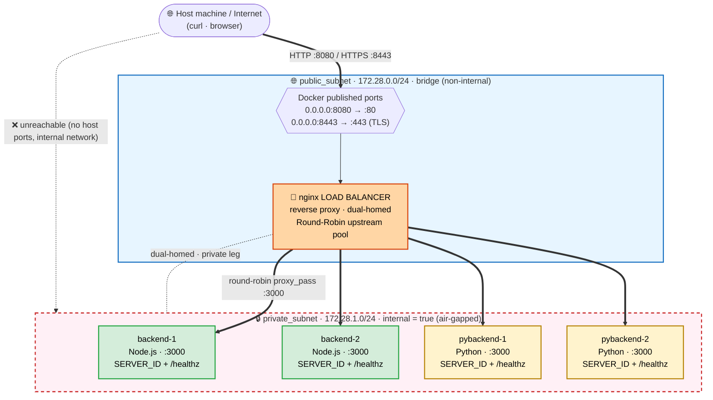

# Multi-Container Multi-Subnet Topology (Terraform + Docker)

An isolated-subnet, reverse-proxy load-balanced web topology provisioned
entirely with Terraform using the Docker provider (networks = subnets).
The backend pool is **heterogeneous**: two apps (Node.js and Python) with the
same SERVER_ID / `/healthz` contract, Round-Robined by a single nginx.

## Architecture
Source lives in `docs/topology.mmd`; you can also paste it into <https://mermaid.live>.



Key isolation properties:

- **public_subnet** - standard bridge network. The load balancer publishes
  ports 80 and 443 to the host through this leg only.
- **private_subnet** - `internal = true` Docker network: no external egress,
  and containers on it can never publish ports to the host. The backend
  containers define **no `ports` blocks at all**.
- The nginx load balancer is **dual-homed** (attached to both networks), making
  it the only possible path between the public and private subnets.
- Both apps sit in the same Round-Robin upstream pool, proving the proxy
  doesn't care what language the backend speaks as long as the contract
  (HTTP + JSON + `/healthz`) is honored.

## Files

| File | Purpose |
|---|---|
| `versions.tf` | Provider requirements (kreuzwerker/docker, hashicorp/tls) |
| `variables.tf` | Tunable knobs (backend counts, ports, subnet CIDRs) |
| `locals.tf` | Backend names (Node + Python) + nginx upstream pool list |
| `networks.tf` | `public_subnet` and `private_subnet` Docker networks |
| `images.tf` | Builds the Node and Python backend images; pulls nginx |
| `tls.tf` | Self-signed certificate for the 443 listener |
| `containers.tf` | Backend replicas (private-only) + dual-homed nginx LB |
| `nginx/default.conf.tpl` | Round-robin upstream + HTTP/HTTPS server blocks (rendered by Terraform) |
| `nginx/nginx.conf` | Base nginx config pinned to `worker_processes 1` so Round-Robin rotation is strict/observable |
| `terraform.tfvars` | Local port overrides (8080/8443 - see note below) |
| `docs/topology.mmd` | Standalone Mermaid source of the network topology diagram |
| `docs/manual-procedures.md` | Manual test procedures (failover demo, isolation proof, log evidence) with observed outputs |
| `tests/run-tests.sh` | Automated acceptance tests (all four required scenarios) |
| `app-node/` | **App #1** - Node.js backend (SERVER_ID responses, `/healthz`, healthcheck) |
| `app-python/` | **App #2** - Python (stdlib-only) backend with the same contract |
| `outputs.tf` | URLs, subnet info, verification command |

## Prerequisites

- Terraform >= 1.5
- Docker (Docker Desktop or a local engine) running

## Deploy

```bash
terraform init
terraform plan
terraform apply        # or: terraform apply -var="backend_count=3" -var="python_backend_count=0"
```

> **Port note (this machine):** a WSL-relayed service (Discourse) already
> squats the loopback bindings on ports 80/443, which shadows Docker's
> published ports on `localhost`. `terraform.tfvars` therefore maps the load
> balancer to **8080 (HTTP)** and **8443 (HTTPS)** instead. Delete or edit
> that file if ports 80/443 are free on your machine.

## Verify the topology

**1. Round-robin distribution across BOTH apps** - repeat requests and watch
`serverId` rotate through every instance in strict order (nginx runs a single
worker, so the rotation is deterministic):

```bash
for i in {1..8}; do curl -s http://localhost:8080/ ; echo; done
# backend-1 ... backend-2 ... pybackend-1 ... pybackend-2 ... repeat
```

**2. Health checks** (proxied through the LB to the backend pool):

```bash
curl -s http://localhost:8080/healthz
```

**3. HTTPS listener** (self-signed cert, so `-k`):

```bash
curl -sk https://localhost:8443/healthz
```


**4. Private subnet isolation** - the backends are NOT reachable directly:

```bash
curl http://localhost:3000        # refused - no host port is published
docker inspect multisubnet-backend-1 --format '{{json .NetworkSettings.Ports}}'
# {}  -> nothing exposed
docker inspect multisubnet-pybackend-1 --format '{{json .NetworkSettings.Ports}}'
# {}  -> nothing exposed
docker network inspect multisubnet-private_subnet --format '{{.Internal}}'
# true -> no external routing on this network
```

**5. Confirm the LB is the only dual-homed container:**

```bash
docker inspect multisubnet-nginx-lb --format '{{range $k,$v := .NetworkSettings.Networks}}{{$k}} {{end}}'
# multisubnet-private_subnet multisubnet-public_subnet
```

## Known limitations

### Static upstream DNS resolution in nginx

`nginx/default.conf.tpl` uses **static** upstream entries (`server backend-1:3000;`
etc., with no `resolve` parameter and no `resolver` directive). nginx resolves
those container hostnames to Docker network IPs **once, at startup**, and then
proxies to the cached IPs indefinitely.

Consequences:

- If a backend is stopped and Docker happens to reassign the **same** IP on
  restart (the common case, since Docker allocates the lowest free address),
  everything works - this is why the automated failover test passes today.
- If a backend returns on a **different IP** (crowded subnet, a Terraform
  recreation of the container while the load balancer keeps running, etc.),
  nginx keeps dialing the dead IP. Failover still protects clients (requests
  retry onto healthy peers after the 2s `proxy_connect_timeout`), but the
  affected backend **effectively never re-enters the rotation** until nginx is
  reloaded/replaced.
- Because of this, the "re-enters the pool" pass in `tests/run-tests.sh` is
  conditional on Docker reusing the IP - it would mask this bug whenever the
  IP is quietly reassigned.

The proper fix (NOT applied, per scope decision) would be to enable dynamic
re-resolution via Docker's embedded DNS, supported by nginx >= 1.27.3:

```nginx
resolver 127.0.0.11 valid=5s ipv6=off;   # Docker's embedded DNS

upstream app_backend {
    server backend-1:3000 resolve;       # re-resolves if the container's IP changes
    ...
}
```

## Automated acceptance tests

A self-contained test suite covering all four required test scenarios
(round-robin distribution, high-availability failover, network isolation,
health/status checks) lives in `tests/run-tests.sh`:

```bash
bash tests/run-tests.sh
```

It runs against the deployed topology, prints a PASS/FAIL line per assertion
and exits non-zero on any failure. Notes:

- **Failover test**: stops `backend-1`, fires 10 requests (asserting zero
  502s / zero dropped requests and 0% traffic to the dead instance), then
  restarts it and asserts it automatically re-enters the rotation. The victim
  is always restarted, even if the script is interrupted (Ctrl-C safe).
- **Isolation test**: proves backends are unreachable via host ports, via
  their container IPs, and that `private_subnet` is `internal=true` - while
  the load balancer remains reachable (positive control).
- **Round-robin test**: 12 requests, asserting no instance serves two
  consecutive requests and distribution is even (+-1). With the default
  2 Node + 2 Python replicas, rotation cycles across all four; run
  `terraform apply -var="python_backend_count=0"` first if your rubric
  requires exactly two instances alternating.
- The browser-based parts of Test 4 (DevTools Network tab, clean console) are
  manual - the script prints step-by-step instructions at the end.

## Teardown

```bash
terraform destroy
```

